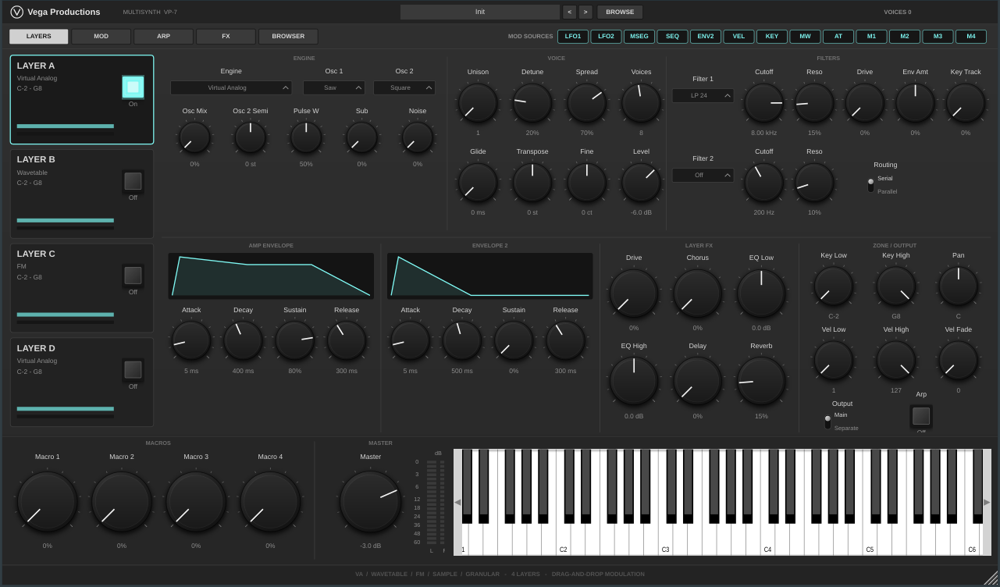
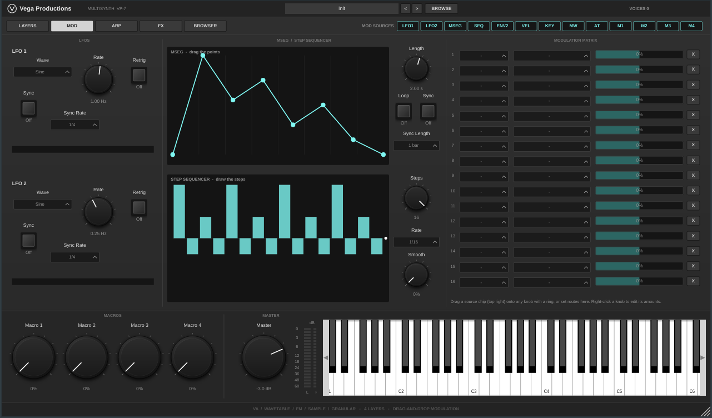
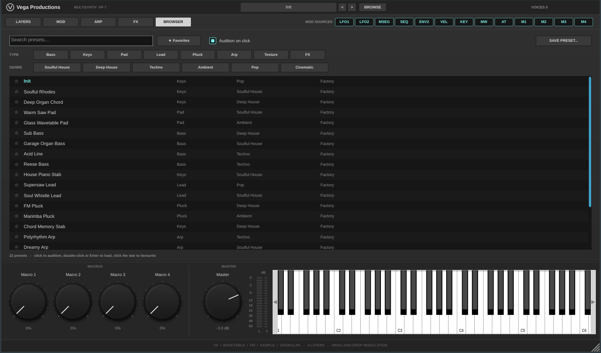

# Vega Productions — Multisynth (VP-7)

A 4-layer multisynth in the Vega Productions suite. Windows VST3, plus macOS VST3 and AU.

## Sound engine
- **5 engines per layer:** Virtual Analog (PolyBLEP, 2 oscillators with sub and noise), Wavetable (6 built-in morphing, band-limited tables), FM (carrier and modulator with ratio and feedback), Sample (load WAV, AIFF, FLAC, OGG or MP3, with root, start and loop), and Granular (grain size, density, spray and position).
- **4 layers** with level, pan, transpose and fine tune, key splits, velocity ranges with crossfades, up to 16 voices, glide, unison up to 7 with detune and stereo spread, and a voice-stealing mode (oldest, quietest, lowest or highest).
- **Two ZDF filters per layer:** LP12, LP24, HP12, HP24, band pass or notch, with drive, envelope amount and key tracking. They run in series or in parallel.
- **Two envelopes per layer:** Amp and Env 2.

## Modulation
- **Drag and drop:** drag a source chip (LFO1, LFO2, MSEG, SEQ, ENV2, VEL, KEY, MW, AT, M1–M4) onto any knob with a ring. The knob shows a cyan ring for the modulation range and a white dot for the live value. Right-click the knob to change or remove amounts.
- **Sources:** 2 LFOs (6 shapes, free or tempo-synced, retrigger), an 8-point MSEG you draw (looping or one-shot, free or synced), a 16-step sequencer you draw, and 4 macros.
- **Mod matrix:** 16 slots on the MOD page.

## Performance
- **Arpeggiator:** Up, Down, Up/Down, Random, As Played or Chord mode; synced rates including triplets and dotted values; 1–4 octaves; gate, swing, step probability, ratcheting with its own chance, and latch. Choose which layers follow it.
- **Chord Memory:** turn it on, play a chord, let go, and from then on each single key plays that chord shape.

## Effects and routing
- **Per layer:** Drive, Chorus, 2-band EQ, and Delay and Reverb sends.
- **Master:** Distortion → Chorus → 3-band EQ, plus a tempo-synced ping-pong Delay and an 8-line FDN Reverb.
- **Multi-output:** set a layer's Output to **Separate**, then enable the *Layer A–D* outputs in your DAW. That layer then gets its own mixer track and skips the master FX.

## Workflow
- **Tagged preset browser:** search, filter by Type and Genre, mark favorites, and audition on click. Save your own presets with tags (stored in `Documents/Vega Productions/Multisynth Presets`). Includes 22 factory sounds, many aimed at soulful and deep house.
- **Resizable window:** drag the corner, from 50% to 200%.

## Install
**Windows (FL Studio):** in **Actions**, open the latest run and download `VegaProductions-Multisynth-Windows-VST3`. Copy `Vega Productions Multisynth.vst3` to `C:\Program Files\Common Files\VST3\`, then in FL Studio go to **Options → Manage plugins → Find more plugins**.

**Mac (Ableton):** download `VegaProductions-Multisynth-macOS-VST3-AU`. Copy the `.vst3` to `~/Library/Audio/Plug-Ins/VST3/` and the `.component` to `~/Library/Audio/Plug-Ins/Components/`, then run `xattr -cr` on both (see the other Vega Productions READMEs).

## Notes on version 1
- Samples are loaded fully into RAM (up to 60 s per layer) rather than streamed from disk.
- Voices are rendered on the audio thread; there's no multicore rendering yet.
